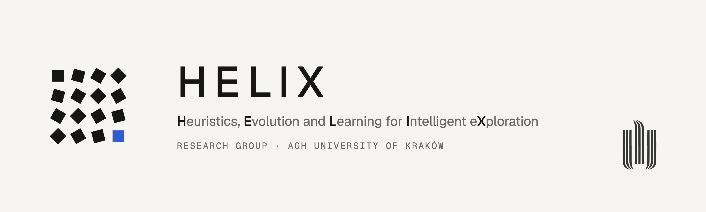

<picture>
  <source media="(prefers-color-scheme: dark)" srcset="helix-banner-dark.png">
  
</picture>

## About Us

HELIX is a research group at AGH University of Kraków focused on computational intelligence, evolutionary computation, landscape analysis and machine learning. We develop innovative algorithms and methodologies for solving complex optimization problems.

## Get Involved

We welcome collaboration with researchers, students, and industry partners. If you're interested in our work:

- Browse our repositories to explore our projects and tools
- Open issues or pull requests to contribute
- Reach out for potential research collaborations

## Contact

AGH University of Kraków
Faculty of Computer Science
Kraków, Poland
